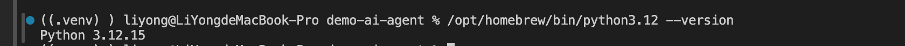
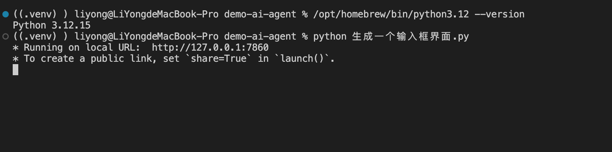

# Python

## 一、Mac 本机版本查询

```bash
python3 --version

# 别名配置
open ~/.zshrc

# 文件最后加入
alias python=python3

python --version
```

## 二、独立的 Python 运行环境

1、安装你想要的版本

```bash
brew install python@x.xx

# 我们以 3.12 为例子
brew install python@3.12
```

2、确认安装版本

```bash
/opt/homebrew/bin/python3.12 --version
```



3、创建

```bash
# 推出旧的局部环境
deactivate

# 使用 Python 3.12 创建新环境
/opt/homebrew/bin/python3.12 -m venv .venv

# 激活
source .venv/bin/activate
```

4、检查

```bash
python --version
python -c "import sys; print(sys.executable)"
```

预期结果类似：

```bash
Python 3.12.x
/Users/xxx/Desktop/github/demo/demo-ai-agent/.venv/bin/python
```

以上就成功了。。。

## 三、实现一个简单的 demo

1、安装依赖

```bash
python -m pip install --upgrade pip
python -m pip install gradio
```

2、demo

```py
import gradio as gr

def reverse_text(text):
  return text[::-1]

demo = gr.Interface(
  fn=reverse_text,
  inputs="text",
  outputs="text"
)

demo.launch()
```

3、运行


